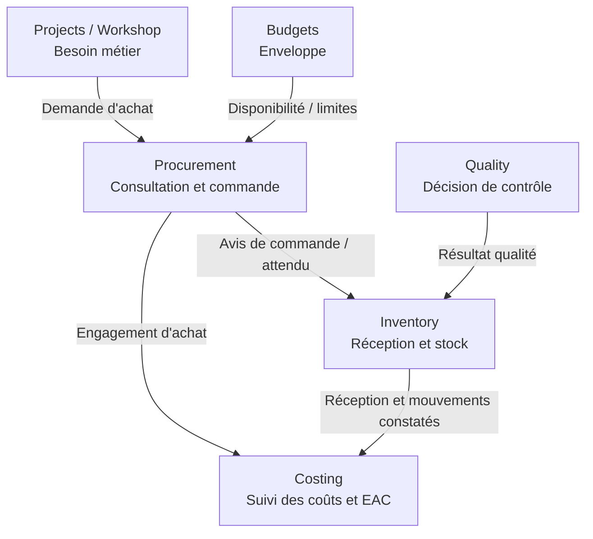
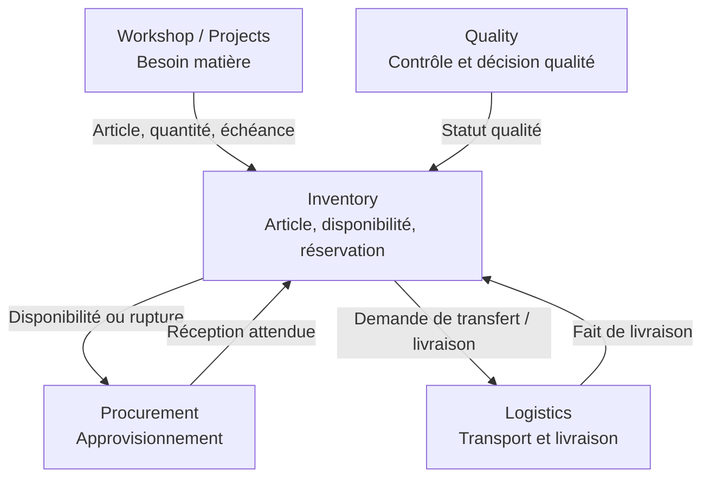
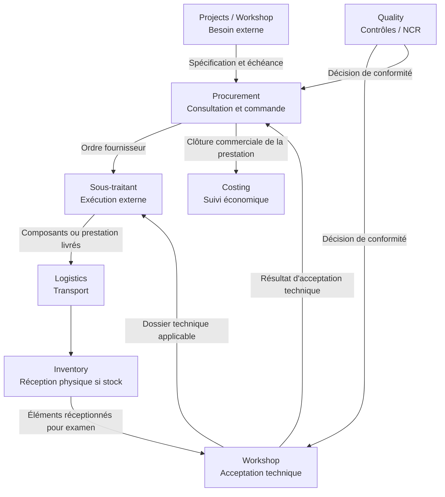
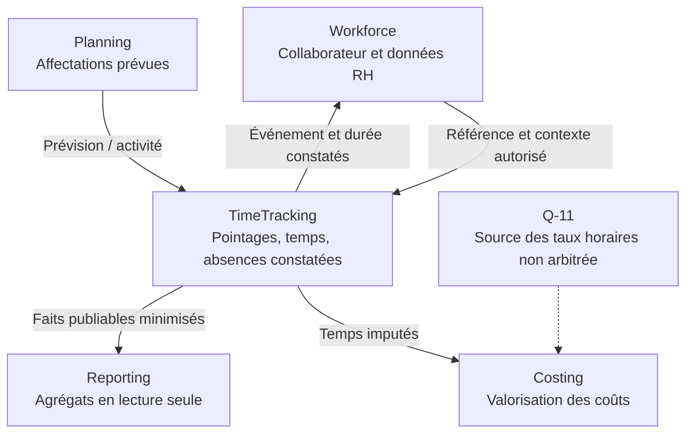
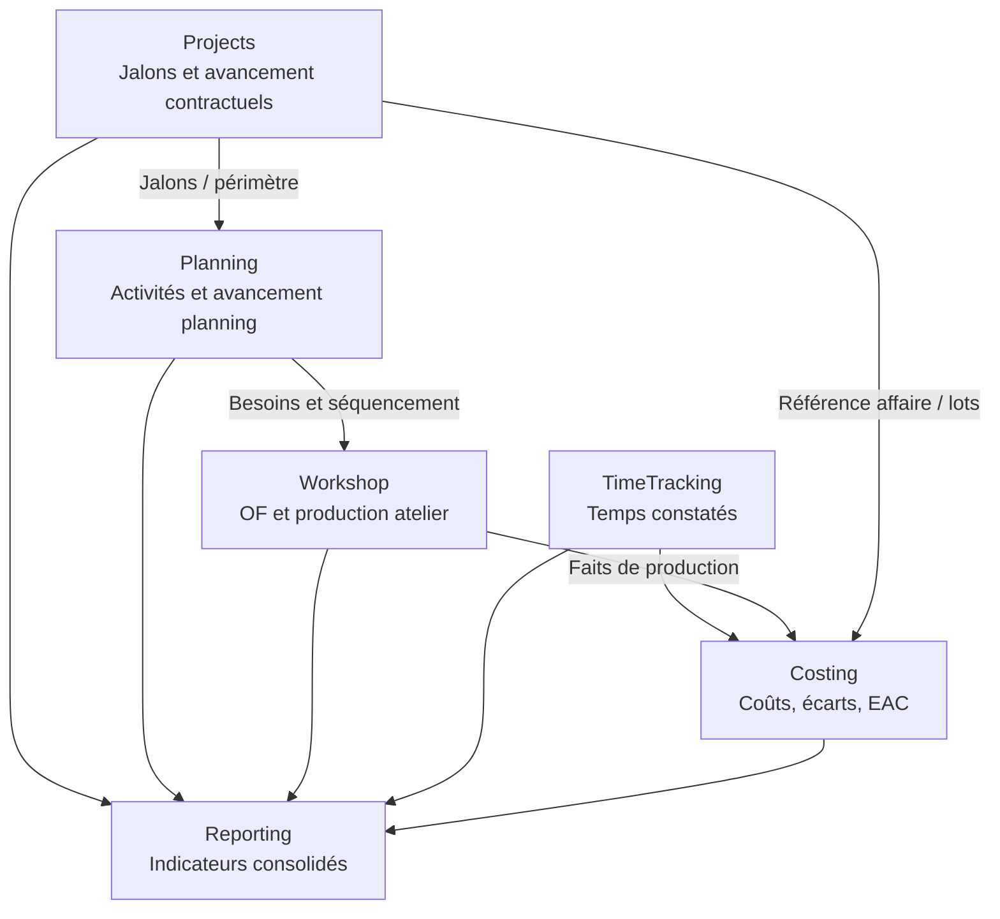
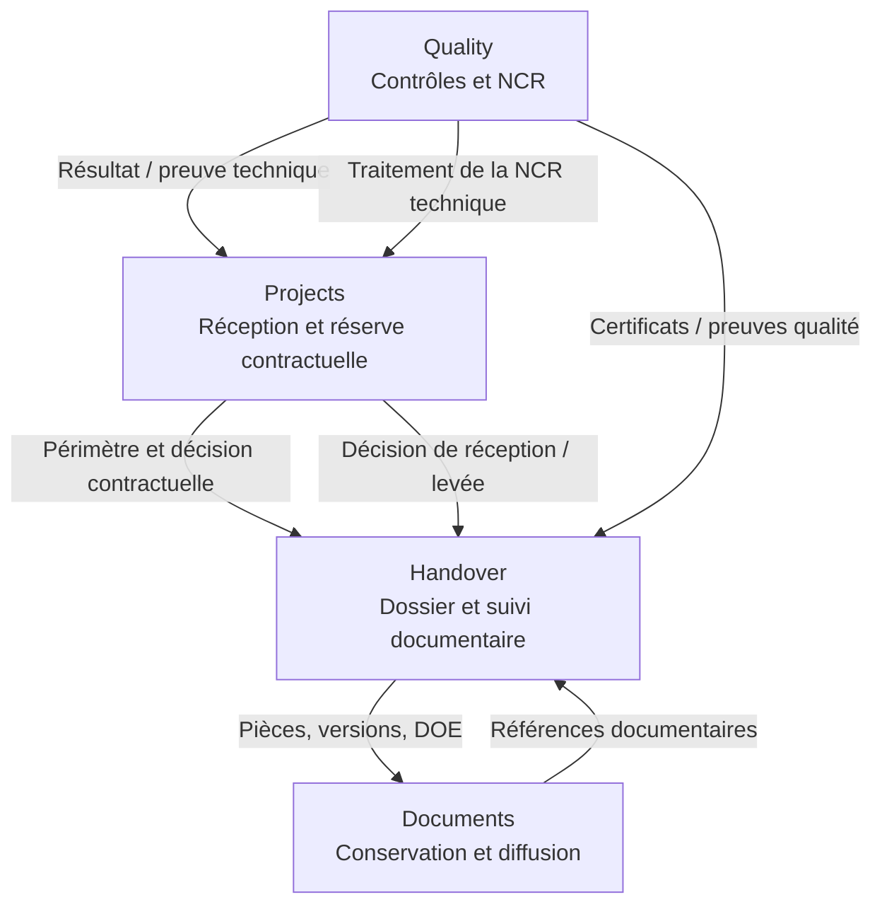
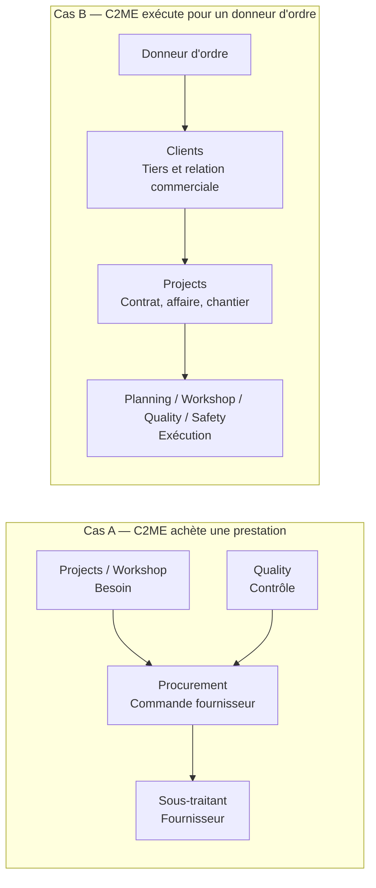
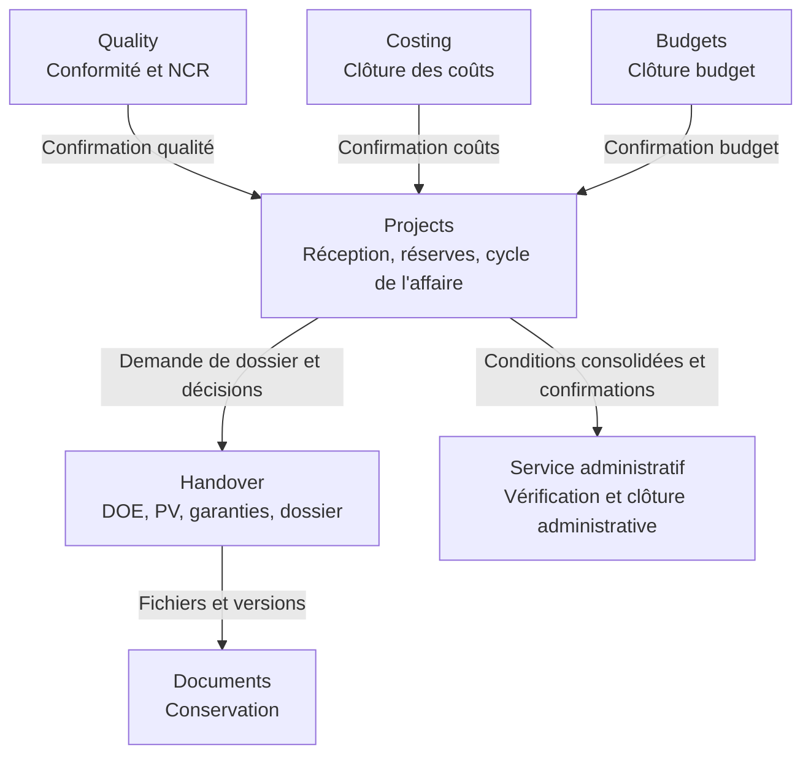

# Lot E — Exemples, schémas et checklist de conformité documentaire

## 1. Objet, portée et statut

Ce document fournit neuf scénarios représentatifs pour rendre lisibles les frontières métier décrites dans CHAN-29 : affaire/chantier, achats et engagement, stock/article, fabrication externe, temps/absences, avancement, qualité/réserves, sous-traitance dans les deux sens et clôture d'affaire.

Il complète les Lots A à D sans requalifier les 130 interactions du Lot C. **Tous les scénarios sont des illustrations métier et des propositions de séquencement ; ils ne prouvent pas l'existence d'un contrat, d'un événement ou d'un appel applicatif.** Les 130 classes techniques demeurent « À qualifier ». Les mécanismes synchrones ou événementiels indiqués sont des orientations de conception à confirmer au moment où un consommateur réel et une capacité fournisseur seront démontrés.

Les diagrammes montrent les responsabilités et les transferts de faits métier. Ils ne décrivent ni des appels PHP existants, ni des transactions distribuées, ni un ordre d'exécution technique garanti.

## 2. Règles de lecture communes

1. **Propriétaire avant consommateur.** Le domaine propriétaire décide de la validité, applique ses invariants et transitions, écrit ses données et publie le fait correspondant.
2. **Pas d'écriture à la place d'un autre domaine.** Un consommateur transmet une demande ou consomme un résultat ; il ne modifie pas directement l'objet du fournisseur.
3. **Une paire réciproque n'est pas un cycle d'appel.** Chaque sens doit représenter une capacité distincte. Un fait accompli repart de son propriétaire ; il ne déclenche pas une modification implicite en retour.
4. **Contrat public ou événement explicite.** Si un échange technique est justifié ultérieurement, il suit CHAN-28. Aucun accès aux Models, Actions, Services, DTO internes, Policies ou tables d'un autre domaine.
5. **Documents ne valide pas le fond.** Documents gère le contenant, les versions, métadonnées, diffusion et conservation ; le domaine métier garde la validité du contenu.
6. **Reporting est en lecture seule.** Il consomme des faits/agrégats publiés et ne devient ni source de vérité ni autorité de décision.
7. **Identifiants publics stables.** Les références inter-domaines d'objets utilisent les UUID stables prévus par les conventions ; aucun Model Eloquent ne traverse une frontière.
8. **Statut documentaire ≠ autorisation technique.** Les exemples ne font passer aucune ligne INT à « Autorisée », « Conditionnelle » ou « Interdite ».

### 2.1 Légende des schémas

- Une flèche pleine représente un transfert conceptuel d'information ou de fait métier, pas un appel technique prouvé.
- Le texte entre crochets identifie le propriétaire du résultat.
- « À qualifier CHAN-29 » signifie qu'une éventuelle dépendance applicative doit être instruite avant implémentation.
- « Synchrone possible » et « événement possible » sont des choix à examiner selon CHAN-28, pas des contrats décidés.

## 3. Scénarios représentatifs

### E-01 — Affaire et chantier : de l'acceptation à la préparation

**Processus :** P01/P02 puis P03.  
**Objectif :** illustrer la frontière entre le référentiel commercial, l'engagement contractuel, le chantier, le budget et le planning initial.

**Séquence métier :**
1. Clients fournit la référence du tiers, ses contacts et rôles commerciaux.
2. Après signature du devis commercial ou réception de la commande, Projects constate l'engagement contractuel ; cette acceptation ne transforme pas automatiquement le devis en affaire.
3. Projects sollicite une validation explicite de l'utilisateur avant toute ouverture. Ce n'est qu'après cette validation que Projects crée l'affaire, le chantier, les lots et les jalons contractuels dont il est propriétaire.
4. À partir du devis accepté, le budget initial est créé avec répartition automatique de ses lignes (V-32), dans le cadre de l'ouverture validée ; Budgets reste propriétaire de l'enveloppe et de ses versions, que Projects ne modifie pas.
5. Planning construit le planning détaillé et les affectations planifiées à partir des besoins et jalons communiqués ; Projects conserve les jalons contractuels.
6. Documents conserve les pièces contractuelles et leurs versions ; il ne décide ni de l'acceptation ni de l'ouverture de l'affaire.

**Propriétaires :** Clients (tiers et devis jusqu'à signature), Projects (affaire, contrat après signature, chantier et jalons contractuels), Budgets (enveloppe), Planning (planning détaillé), Documents (contenants documentaires).

```mermaid
flowchart TD
    C[Clients\nTiers et devis commercial] -->|Référence tiers / devis signé| P[Projects\nContrat et engagement]
    P -->|Demande de validation explicite| U[Utilisateur\nConfirmation d'ouverture]
    U -->|Validation explicite (V-30)| P2[Projects\nAffaire et chantier]
    P2 -->|Devis accepté / lignes du budget initial (V-32)| B[Budgets\nEnveloppe et versions]
    P2 -->|Jalons contractuels et besoins| PL[Planning\nActivités et affectations]
    P2 -->|Pièces à conserver| D[Documents\nVersions et diffusion]
    B -->|Budget validé / disponible| P2
    PL -->|Planning publié / alertes| P
```

**Frontières à préserver :**
- Clients reste propriétaire du devis complet jusqu'à signature ; Projects ne reconstitue pas une source commerciale parallèle.
- Projects garde le cycle de vie de l'affaire ; Planning ne devient pas propriétaire des jalons contractuels.
- Budgets possède l'enveloppe ; Costing possède les coûts, engagements, imputations et EAC.
- Documents ne valide pas le contenu métier.
- Relations techniques éventuelles : « À qualifier » dans CHAN-29 ; appliquer CHAN-28 après démonstration du besoin.

### E-02 — Achats et engagement : du besoin à la commande

**Processus :** P03/P05.  
**Objectif :** distinguer le besoin opérationnel, la disponibilité budgétaire, l'engagement d'achat et la réception en stock.

**Séquence métier :**
1. Le domaine demandeur (par exemple Projects ou Workshop) exprime un besoin identifié, quantifié et daté ; il ne crée pas une commande fournisseur.
2. Procurement instruit la consultation, compare les offres, choisit le fournisseur et porte la commande ainsi que l'engagement d'achat.
3. Budgets fournit le cadre de l'enveloppe et de sa disponibilité ; il ne passe pas la commande.
4. Costing suit l'engagement et ses effets sur les coûts/EAC ; il ne devient pas propriétaire de la commande.
5. Inventory réalise la réception physique et les mouvements de stock dont il est propriétaire, avec les contrôles requis.
6. Les écarts de réception sont traités par les domaines responsables ; une acceptation qualité relève de Quality, pas de Procurement ni de Documents.

**Propriétaires :** Procurement (fournisseurs, consultation, commande et engagement), Budgets (enveloppe), Costing (coûts/engagements valorisés), Inventory (réception et stock), Quality (contrôle qualité).



**Frontières à préserver :**
- Procurement possède la relation d'achat et la commande ; Clients possède le référentiel maître des tiers.
- Inventory possède le référentiel article et les mouvements ; Procurement conserve les références fournisseur propres aux achats.
- Budgets ne valide pas la réception ; Costing ne modifie pas la commande.
- Les règles de validation budgétaire, de délégation et de seuil doivent rester dans leur domaine propriétaire.

### E-03 — Stock et article : consultation, réservation et mouvement

**Processus :** P05/P06/P08.  
**Objectif :** illustrer la distinction entre référentiel article, stock physique, besoin de fabrication et besoin logistique.

**Séquence métier :**
1. Inventory possède l'article, ses unités, dépôts, emplacements, lots et quantités disponibles.
2. Workshop ou Projects exprime un besoin de matière ou de composants avec une référence d'article stable et une quantité.
3. Inventory vérifie la disponibilité et décide de la réservation, de la sortie ou du mouvement selon ses propres règles.
4. Si le stock est insuffisant, Procurement traite le besoin d'achat ; il ne crée pas lui-même le stock.
5. Logistics organise le transport ou le transfert physique lorsque requis ; la livraison ne modifie pas directement le référentiel article.
6. Les écarts, rebuts ou non-conformités sont signalés au propriétaire compétent ; Quality décide de la conformité technique.

**Propriétaires :** Inventory (article et stock), Workshop (besoin/consommation de fabrication), Projects (besoin chantier), Procurement (achat), Logistics (transport), Quality (conformité).



**Frontières à préserver :**
- Aucun domaine ne maintient une copie faisant autorité du stock.
- Une quantité affichée ailleurs est une projection ou une copie explicitement non maîtresse.
- Logistics possède le fait de transport/livraison ; Inventory possède le mouvement de stock.
- La disponibilité calculée doit être fournie par Inventory ; elle ne doit pas être recalculée à partir de tables internes par le consommateur.

### E-04 — Fabrication externe : sous-traitant intervenant pour C2ME

**Processus :** P07, branche « C2ME donneur d'ordre ».  
**Objectif :** distinguer l'achat d'une prestation externe, la préparation technique, la livraison et l'acceptation qualité.

**Séquence métier :**
1. Projects ou Workshop identifie une opération à faire réaliser à l'extérieur et transmet le besoin, le périmètre, les spécifications et l'échéance.
2. Procurement consulte le marché, sélectionne le sous-traitant et porte la commande/prestation et les engagements.
3. Workshop conserve la responsabilité de la préparation technique et de l'intégration de la fabrication dans le processus atelier lorsque cela relève de son périmètre ; le sous-traitant exécute la prestation commandée.
4. Quality définit/porte les contrôles et statue sur la conformité technique ainsi que sur les éventuelles NCR selon le plan applicable.
5. Workshop prononce l'acceptation technique de la fabrication externe dans son périmètre, distinctement de la décision de conformité de Quality.
6. Procurement clôt l'aspect commercial de la prestation, distinctement des décisions techniques et qualité.
7. Logistics organise les enlèvements/livraisons si nécessaire ; Inventory constate la réception physique des composants dans le stock lorsque ceux-ci entrent dans son périmètre.
8. Costing suit les coûts et écarts ; il ne prononce ni l'acceptation technique ni la conformité.

**Propriétaires :** Procurement (relation d'achat et commande), Workshop (OF/gamme/opérations internes), Quality (contrôles/NCR), Logistics (transport), Inventory (réception et stock), Costing (coûts).



**Frontières à préserver :**
- Procurement possède la relation d'achat et la commande ; le sous-traitant est fournisseur dans ce sens.
- Workshop ne délègue pas au sous-traitant la propriété de ses OF internes ou de ses règles de production.
- Quality garde la décision de conformité ; Procurement ne transforme pas une livraison en acceptation technique.
- Les garanties fournisseurs/sous-traitants relèvent de Procurement ; les garanties clientes documentaires relèvent de Handover.

### E-05 — Temps et absences : constat opérationnel et qualification RH

**Processus :** P10, avec contribution à P04.  
**Objectif :** respecter la séparation validée entre les faits de temps, les données RH et la planification.

**Séquence métier :**
1. Workforce possède le collaborateur, son contrat, son poste, ses qualifications et son équipe.
2. Planning exprime les activités et affectations prévues ; il ne possède pas les pointages ni les absences constatées.
3. TimeTracking collecte les pointages, feuilles de temps, imputations, corrections et événements d'absence constatés.
4. Workforce qualifie le motif RH et ses conséquences administratives à partir des informations nécessaires ; il ne réécrit pas le fait de temps détenu par TimeTracking.
5. Costing consomme les temps imputés et les règles de valorisation applicables pour calculer les coûts ; il ne devient ni propriétaire du pointage ni de la paie.
6. Reporting peut agréger des indicateurs selon les droits et la confidentialité, sans accès direct aux tables RH ou de temps.

**Propriétaires :** Workforce (données RH et qualification du motif), Planning (prévision/affectations), TimeTracking (temps constatés), Costing (valorisation des coûts), Reporting (agrégats publiés).



**Frontières à préserver :**
- V-21 : TimeTracking constate les événements/durées ; Workforce qualifie le motif RH.
- Les absences planifiées et les absences constatées ne sont pas le même fait.
- Les données RH sensibles sont minimisées et protégées ; Reporting applique les règles de confidentialité.
- Q-11 reste ouverte pour la propriété/source des taux horaires ; ne pas inventer un arbitrage.

### E-06 — Avancement : contractuel, planning et production

**Processus :** P09/P10.  
**Objectif :** distinguer l'avancement contractuel de l'affaire, l'avancement du planning et les faits de production/temps.

**Séquence métier :**
1. Projects possède les lots, jalons et avancement contractuels de l'affaire/chantier.
2. Planning possède les activités, dates prévues, affectations et avancement du planning.
3. Workshop possède les ordres de fabrication, opérations et états de production atelier.
4. TimeTracking possède les temps réellement constatés et imputés.
5. Costing valorise les coûts, écarts et EAC à partir des faits pertinents ; il ne décide pas de l'avancement contractuel.
6. Reporting consolide les indicateurs publiés et garde la lignée vers leurs sources.



**Frontières à préserver :**
- Un pourcentage d'avancement planning ne devient pas automatiquement un avancement contractuel.
- Workshop publie les faits de production ; Projects décide de l'avancement contractuel selon ses règles.
- TimeTracking ne calcule pas les coûts ; Costing ne modifie pas les pointages.
- Reporting n'est pas source de décision ; en cas d'écart, la source métier fait foi.

### E-07 — Qualité et réserves : non-conformité technique versus réserve contractuelle

**Processus :** P11/P12.  
**Objectif :** appliquer V-26 et V-55 sans confondre NCR technique, réserve contractuelle et dossier documentaire.

**Séquence métier :**
1. Quality planifie les contrôles, enregistre les résultats et porte les non-conformités techniques (NCR), actions et preuves.
2. Projects porte la réception contractuelle, enregistre les réserves contractuelles et décide de leur issue/levée.
3. Une réserve contractuelle ayant une cause technique reste ouverte tant que la NCR correspondante n'a pas été traitée ; sa clôture ne peut intervenir avant ce traitement. Une réserve uniquement documentaire peut être clôturée sans NCR. Dans tous les cas, la clôture documentaire opérée par Handover ne clôture pas la NCR, qui reste sous la responsabilité de Quality.
4. Handover prépare et centralise le dossier de réception, les réserves/levées et les preuves documentaires ; il ne prononce pas la réception ni la levée contractuelle.
5. Documents conserve les fichiers, versions et métadonnées ; le propriétaire métier valide le fond.
6. Projects organise la réception ; le PV constate la décision contractuelle portée par Projects.



**Frontières à préserver :**
- V-26 : réserve contractuelle et NCR technique sont deux objets distincts ; une réserve à cause technique ne peut être clôturée avant le traitement de la NCR correspondante, tandis qu'une réserve uniquement documentaire peut être clôturée sans NCR.
- V-55 : Projects organise et porte la réception contractuelle ; Handover prépare/centralise les livrables.
- Quality reste propriétaire de la conformité technique et des NCR.
- Documents ne valide ni la conformité technique ni la décision contractuelle.

### E-08 — Sous-traitance dans les deux sens : deux processus, deux rôles

**Processus :** P07.  
**Objectif :** appliquer V-27 et éviter de confondre un achat de prestation avec une commande de travaux reçue par C2ME.

**Cas A — C2ME donneur d'ordre :**
- Procurement sélectionne le sous-traitant, porte la relation d'achat, la commande et les engagements.
- Projects/Workshop définit le besoin et le périmètre technique selon la nature de l'opération.
- Quality contrôle la conformité technique ; Logistics gère les flux physiques éventuels.
- Le sous-traitant est fournisseur de C2ME.

**Cas B — C2ME sous-traitant exécutant :**
- Clients possède le donneur d'ordre comme tiers et la relation commerciale.
- Projects porte l'affaire, l'engagement contractuel reçu, le chantier, les lots et l'exécution contractuelle après signature.
- Planning organise les activités ; Workshop fabrique si nécessaire ; Procurement achète les fournitures nécessaires ; Quality/Safety portent leurs contrôles et exigences.
- Le donneur d'ordre est le client de C2ME dans ce contexte, pas un fournisseur au seul motif qu'il émet une commande.



**Frontières à préserver :**
- Les deux cas ne sont pas deux directions d'une même commande.
- Le rôle du tiers dépend de la relation considérée ; ne pas déduire « fournisseur » du seul fait qu'une entité émet une commande.
- Clients reste propriétaire du référentiel maître des tiers ; Procurement porte les données spécifiques à la relation d'achat.
- Les règles de garanties fournisseurs/sous-traitants et garanties clientes restent distinctes (Q-44 ouverte pour les frontières de garanties concernées).

### E-09 — Clôture d'affaire : réception, réserves, DOE, coûts et décision administrative

**Processus :** P12.  
**Objectif :** rendre explicite la séquence validée V-28/V-59 et les rôles Projects, Handover, Quality, Documents, Costing, Budgets et service administratif.

**Séquence métier :**
1. Projects organise la réception contractuelle et porte la décision de réception ainsi que le cycle de vie de l'affaire.
2. Quality confirme le statut des contrôles et NCR relevant de son périmètre.
3. Projects suit les réserves contractuelles et décide de leur levée/refus ; Handover en assure le suivi documentaire.
4. Handover prépare et centralise le DOE, les PV, attestations, garanties clientes et dossier documentaire de clôture ; Documents conserve les fichiers et versions.
5. Costing confirme la clôture des coûts et les éléments de situation finale ; Budgets confirme la clôture de l'enveloppe selon ses propres règles.
6. Les domaines propriétaires confirment leurs obligations respectives.
7. Projects coordonne la vérification des conditions contractuelles de clôture ; le service administratif vérifie les conditions réunies et prononce la clôture administrative (V-59).



**Frontières à préserver :**
- V-28 : clôture de l'affaire après réception, levée des réserves, DOE, clôture des coûts et clôture du budget.
- V-59 : Projects conserve le cycle de vie de l'affaire ; le service administratif vérifie les conditions et prononce la clôture administrative.
- Handover clôt le dossier documentaire, pas l'affaire ni la décision administrative.
- Le DOE est préparé/centralisé par Handover ; Documents gère le contenant ; les domaines propriétaires valident le contenu relevant de leur compétence.
- La garantie fournisseur/sous-traitant relève de Procurement ; la garantie cliente documentaire relève de Handover. Q-44 reste à arbitrer pour les détails non tranchés.

## 4. Checklist de conformité documentaire par domaine

Cette checklist sert à relire les documents de frontière, les exemples, les contrats futurs et les schémas. Elle ne constitue pas un test d'architecture automatisé (CHAN-31) et ne vaut pas audit de code.

| Domaine | Vérifications documentaires attendues |
| --- | --- |
| Identity | [ ] Décrire uniquement les besoins d'authentification/autorisation des points d'entrée réels. [ ] Ne pas lui attribuer les données RH, clients ou fournisseurs. [ ] Expliciter les droits et périmètres nécessaires sans dépendance métier universelle. |
| Clients | [ ] Identifier le tiers maître, contacts et rôles commerciaux. [ ] Maintenir le devis commercial complet jusqu'à signature. [ ] Distinguer le référentiel maître des données spécifiques d'achat de Procurement. |
| Projects | [ ] Décrire l'affaire, le contrat après signature, le chantier, les lots, jalons et avancement contractuels. [ ] Ne pas lui attribuer le planning détaillé, le budget, les coûts, la conformité ou les livrables documentaires. [ ] Porter l'organisation et la décision contractuelles de réception. |
| Planning | [ ] Distinguer jalons contractuels et activités/affectations planifiées. [ ] Identifier les besoins et contraintes consommés. [ ] Ne pas lui attribuer les données RH, pointages, actifs ou capacité atelier. |
| Budgets | [ ] Identifier l'enveloppe, ses versions et révisions. [ ] Distinguer disponibilité budgétaire, commande/engagement et coût constaté. [ ] Ne pas lui attribuer le chiffrage détaillé ou la commande fournisseur. |
| Costing | [ ] Décrire chiffrage, coûts, engagements valorisés, imputations, marge et EAC. [ ] Identifier les sources et règles de valorisation sans devenir propriétaire des pointages, commandes, stocks ou budgets. [ ] Signaler Q-11 et autres arbitrages encore ouverts. |
| Workforce | [ ] Décrire collaborateurs, contrats, postes, qualifications et équipes. [ ] Distinguer qualification RH des événements/temps constatés. [ ] Protéger les données RH et les taux non arbitrés. |
| TimeTracking | [ ] Décrire pointages, feuilles de temps, imputations, corrections et absences constatées. [ ] Ne pas qualifier seul les motifs RH ni gérer les contrats. [ ] Préserver V-21. |
| Workshop | [ ] Décrire OF, gammes, opérations, postes et faits de production. [ ] Distinguer stock (Inventory), achats (Procurement), transport (Logistics) et conformité (Quality). [ ] Ne pas exposer d'internals aux consommateurs. |
| Procurement | [ ] Décrire fournisseurs/sous-traitants dans la relation d'achat, consultations, commandes et engagements. [ ] Distinguer Clients comme référentiel maître des tiers. [ ] Distinguer garanties fournisseurs/sous-traitants des garanties clientes. |
| Inventory | [ ] Décrire articles, dépôts, emplacements, lots, réceptions et mouvements de stock. [ ] Rester source de vérité du stock. [ ] Ne pas porter la commande fournisseur, le transport ou la décision qualité. |
| Equipment | [ ] Décrire parc, affectations, maintenance, inspections, certificats et pannes. [ ] Distinguer disponibilité du parc, transport et achat. [ ] Ne pas exposer de données internes au consommateur. |
| Logistics | [ ] Décrire demandes/plans de transport, tournées, livraisons site et retours. [ ] Distinguer livraison physique et mouvement de stock. [ ] Ne pas porter la commande, la fabrication ou la réception contractuelle. |
| Quality | [ ] Décrire plans de contrôle, essais, résultats, NCR, actions et certificats. [ ] Distinguer NCR technique et réserve contractuelle (V-26). [ ] Ne pas prononcer la réception contractuelle. |
| Safety | [ ] Décrire prévention, risques, inspections, incidents, habilitations et autorisations opérationnelles. [ ] Distinguer habilitation opérationnelle et données RH. [ ] Ne pas prendre la propriété de la maintenance ou de la conformité produit. |
| Documents | [ ] Décrire fichiers, versions, métadonnées, diffusion, conservation et archives. [ ] Identifier le domaine propriétaire du contenu et de sa validation de fond. [ ] Ne pas prendre de décision métier ou technique. |
| Handover | [ ] Décrire préparation/centralisation du dossier de réception, DOE, PV, suivi documentaire des réserves/levées et garanties clientes. [ ] Ne pas prononcer réception, levée de réserve ou clôture administrative. [ ] Distinguer garanties fournisseurs/sous-traitants (Procurement). |
| Reporting | [ ] Identifier pour chaque indicateur sa source, son propriétaire, sa formule, sa période et son consommateur. [ ] Consommer des publications/contrats publics en lecture seule. [ ] Ne jamais écrire dans les domaines ni devenir autorité métier. |

## 5. Checklist transversale d'un exemple ou schéma

Avant d'intégrer un nouvel exemple, vérifier tous les points suivants :

- [ ] Le processus P et les interactions INT concernés sont identifiés ou le scénario est explicitement présenté comme illustration sans nouvelle interaction.
- [ ] Le consommateur et le fournisseur sont nommés selon la capacité consommée, pas selon le sens matériel du flux.
- [ ] Le propriétaire de chaque donnée, invariant, état, transition et décision est explicite.
- [ ] Les demandes, décisions et faits accomplis sont distingués.
- [ ] Une paire réciproque représente deux capacités séparées et ne crée pas un aller-retour synchrone implicite.
- [ ] Aucun domaine ne lit ou n'écrit directement les tables ou composants internes d'un autre domaine.
- [ ] Aucun Model Eloquent, Builder, Collection Eloquent, Request, objet de présentation ou DTO interne ne traverse la frontière.
- [ ] Un contrat ou événement n'est proposé que pour un consommateur réel et une capacité justifiée.
- [ ] Le choix synchrone/événementiel, l'erreur, l'indisponibilité, la reprise et l'idempotence sont renvoyés aux règles CHAN-28.
- [ ] Les UUID publics stables sont utilisés pour les références d'objets.
- [ ] Les données sensibles sont minimisées et les droits d'accès identifiés.
- [ ] Documents reste propriétaire du contenant, pas du fond métier.
- [ ] Reporting reste un consommateur en lecture seule.
- [ ] Les questions ouvertes (notamment Q-11, Q-24, Q-29, Q-31, Q-44) sont signalées sans arbitrage implicite.
- [ ] La classe technique demeure « À qualifier » tant qu'une preuve et une validation explicites ne sont pas disponibles.

## 6. Limites et points ouverts

- Les exemples décrivent des responsabilités cibles documentées ; ils ne prouvent pas que les processus sont implémentés.
- Les 130 interactions du Lot C restent techniquement « À qualifier ».
- Q-11 (taux horaires), Q-24 (capacité atelier), Q-29 (EPI/autorisations), Q-31 (propriété DOE) et Q-44 (garanties) restent ouvertes selon les arbitrages recensés.
- Les mécanismes proposés dans les schémas doivent être instruits au regard des contrats synchrones et événements de CHAN-28 au moment de l'implémentation.
- La checklist documentaire ne remplace pas les tests d'architecture CHAN-31 ni un audit des accès internes après implémentation.

## 7. Références

- [Responsabilités des domaines](domain-responsibilities.md)
- [Cartographie des processus métier](business-processes.md)
- [Catalogue des objets métier](business-objects.md)
- [Registre des interactions métier](domain-interactions-register.md)
- [Registre de qualification des interactions](domain-dependency-register.md)
- [Matrice technique Lot C](domain-dependency-matrix-lot-c.md)
- [Matrice consolidée et analyse des cycles — Lot D](domain-dependency-matrix-lot-d.md)
- [Communication inter-domaines — CHAN-28](domain-communication.md)
- [Conventions internes — CHAN-27](domain-conventions.md)
- CHAN-31 — Tests d'architecture

## 8. Traçabilité

- Lot : E — exemples, schémas et checklist.
- Base : branche `develop` après fusion de la PR #31.
- Périmètre : documentation uniquement.
- Aucun contrat PHP, DTO, événement, listener, job, provider, service, migration, test d'architecture ou changement Jira n'est inclus.
- Les classes techniques du Lot C ne sont pas modifiées.
